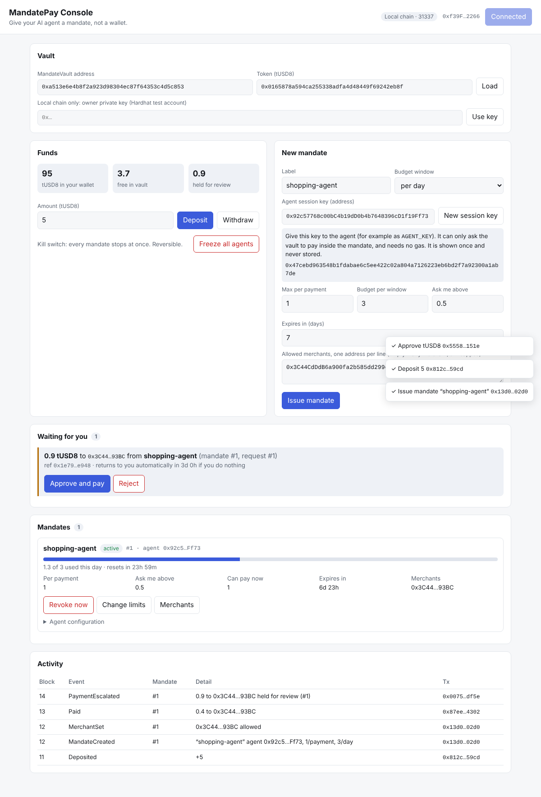

# MandatePay — spending mandates for AI agents on QDay Aevum

Give your AI agent a **mandate**, not a wallet.

**Demo video (2:40):** [video/mandatepay-demo.mp4](video/mandatepay-demo.mp4) · **Live console:** https://class-now.github.io/mandatepay/

AI agents are starting to buy things: API credits, train tickets, cloud hours, data. Today the choice is bad either way. Hand the agent a funded private key and one prompt injection can drain it. Make it ask a human for every purchase and it is no longer an agent.

MandatePay sits in between. The owner keeps tUSD8 in a vault on Aevum testnet and issues each agent a mandate: a session key that can pay

- only **allow-listed merchants**,
- only up to a **per-payment cap** and a **rolling budget** (for example 20 per payment, 50 per day),
- only **until it expires**,
- and only **until the owner revokes it** (one transaction, effective in the same block).

Payments above a **review threshold** are not sent. They are held in the vault and wait for the owner's one-tap approval: the agent keeps working on small things and escalates big ones. Each payment carries a **reference** (invoice or order id) that can be paid once per mandate, so an agent that times out and retries cannot pay twice. Agents **never need gas**: they sign a payment intent (EIP-712) and any relayer submits it.

Everything settles on Aevum, and every decision leaves an event: `Paid`, `PaymentEscalated`, `EscalationResolved`, `MandateRevoked`.

## Who it is for

- **Developers running agents** that call paid APIs or buy services, who need a hard ceiling that does not depend on the model behaving.
- **Small businesses** that let an assistant pay recurring suppliers (hosting, SaaS, couriers) within a monthly budget, with large invoices routed to a person.
- **Agent platforms** that want to offer users "spend up to X on my behalf" as a product feature.

## How it works

```
 Owner (wallet)                      MandateVault (Aevum)                       Merchant
 ─────────────                       ────────────────────                       ────────
 deposit tUSD8  ───────────────────▶ balanceOf[owner]
 createMandate(agent, caps, ...) ──▶ Mandate #n  ──── allow-list, caps, expiry, review threshold

 Agent (session key, no gas)
 sign PaymentIntent(n, merchant, amount, ref, deadline)
          │
          ▼
 Relayer ── payWithSig ────────────▶ checks: signature · not revoked · not expired · not frozen
                                             merchant allowed · amount ≤ perTxCap
                                             ref unused · spent + amount ≤ budget · funds
                                     amount ≤ reviewAbove ── transfer ───────────▶ tUSD8
                                     amount > reviewAbove ── hold, PaymentEscalated
 approvePending / rejectPending ───▶ transfer held funds ─────────────────────▶ tUSD8
 revoke / setFrozen ───────────────▶ every later intent fails
```

### Contract: `contracts/MandateVault.sol`

| Function | Who | What |
|---|---|---|
| `deposit(amount)` / `depositWithAuthorization(...)` | owner | Fund the vault (with `approve`, or gasless with tUSD8's EIP-3009 `receiveWithAuthorization`) |
| `withdraw(amount, to)` | owner | Take back free balance (held funds stay held) |
| `createMandate(agent, perTxCap, budget, period, expiresAt, reviewAbove, label, merchants[])` | owner | Issue a mandate. Empty `merchants` = any merchant, still capped |
| `updateLimits`, `setMerchant` | owner | Change caps, threshold, expiry or the allow-list |
| `revoke(id)` | owner | End a mandate, instantly and for good |
| `setFrozen(bool)` | owner | Kill switch for all of the owner's mandates (reversible) |
| `pay(id, merchant, amount, ref)` | agent | Pay directly (agent has gas) |
| `payWithSig(id, merchant, amount, ref, deadline, sig)` | anyone | Gasless: submit the agent's signed intent. ERC-1271 agents (smart accounts) work too |
| `approvePending` / `rejectPending` | owner | Answer an escalated payment |
| `expirePending` | anyone | After 3 days, return an unanswered request's funds to the owner |
| `getMandate`, `spendableNow`, `getPending`, `intentDigest` | view | State for UIs and agents |

Design choices:

- **Least privilege by default.** The agent key can do exactly one thing: ask the vault to pay within its mandate. It cannot withdraw, change limits, or move funds anywhere else.
- **Idempotent payments.** `ref` is single-use per mandate, so retries are safe. A rejected request keeps its `ref` used: the merchant issues a new invoice instead of the agent silently trying again.
- **Budget windows are aligned** (`periodStart` moves in whole periods), so a daily budget cannot be stretched by timing payments around the reset.
- **Held, not promised.** Escalated amounts leave the owner's free balance and the budget immediately, so the owner cannot accidentally overspend while a request waits, and approval always succeeds.
- **Shanghai EVM.** Compiled with `evmVersion: "shanghai"` and no transient storage, as Aevum requires.

## Run it

Needs Node 22+.

```bash
npm install
npm test          # 18 tests: caps, budget windows, allow-list, revoke, freeze, expiry,
                  # escalation approve/reject/expire, gasless intents, replay and tamper checks
npm run demo      # the full story on a local Shanghai chain with a stand-in tUSD8
```

`npm run demo` prints one line per step:

```
1. Owner deposits 5 tUSD8
2. Owner issues a mandate: 1/payment, 3/day, review above 0.5, 7 days, one merchant
3. Agent pays invoice INV-1001 (0.4) gaslessly through the relayer         -> ok
4. Agent times out and retries INV-1001: refused, no double payment        -> RefAlreadyUsed
5. Agent tries 1.5 in one payment: over the per-payment cap                -> OverPerTxCap
6. Agent pays 0.9: above the review threshold, held for the owner          -> escalated, owner approves
7. Owner revokes the mandate; the agent's next intent fails                -> MandateRevokedError
```

### On Aevum testnet

| | |
|---|---|
| Network | QDay Aevum Testnet, chain ID `44005` |
| RPC | `https://rpc-test.qday.info` |
| Explorer | https://explorer-test.qday.info |
| tUSD8 | `0x456569838f1d43009A91ebA4263147Afd7233483` (6 decimals, EIP-2612 / EIP-3009) |
| **MandateVault (deployed)** | [`0xe990d83f74ae1adf11360dd3af69eb8470768f22`](https://explorer-test.qday.info/address/0xe990d83f74ae1adf11360dd3af69eb8470768f22) (block 3746666) |

**Live run on Aevum testnet** (2026-11-21, real tUSD8, full log in `docs/aevum-demo.txt`):

| Step | Result | Transaction |
|---|---|---|
| 1. Owner deposits 5 tUSD8 | ok | [approve](https://explorer-test.qday.info/tx/0x1b5a09e5744510bab85bf6b544ed3e6ac531df7ae917e0b953234eacd35385b9) · [deposit](https://explorer-test.qday.info/tx/0x1e40169a6e70ed3d03081717043891ecf153b444649b6cffab405277dc6a585d) |
| 2. Owner issues mandate #1 (1/payment, 3/day, review above 0.5, 7 days, one merchant) | ok | [createMandate](https://explorer-test.qday.info/tx/0xff45c15219f2fcc089da2ede8570b5d0644b0208f77d41199e45a743757b3949) |
| 3. Agent pays INV-1001 (0.4) gaslessly via the relayer | ok | [payWithSig](https://explorer-test.qday.info/tx/0x8d0240f5de9c1e208c4ea2e3769c4a714b4557adf47103bc924a7389128845d4) |
| 4. Retry of INV-1001 | blocked: `RefAlreadyUsed` | (no transaction) |
| 5. 1.5 in one payment | blocked: `OverPerTxCap` | (no transaction) |
| 6. 0.9, above the review threshold: held, then approved | ok | [held](https://explorer-test.qday.info/tx/0x6769572d82e23d5979e1f0b76fda52b460874a4b95ddf9be34d9e7d6228b64c3) · [approvePending](https://explorer-test.qday.info/tx/0xb54fff381e668f69154fdc18fa986b2c84059ed06ed74d7f748f9ba6bd373621) |
| 7. Owner revokes; the agent's next intent fails | ok / blocked: `MandateRevokedError` | [revoke](https://explorer-test.qday.info/tx/0xeefb951ae0965548320dd45cdee6ef3c86545967168bb9353289d668093741ba) |

The merchant received 1.3 tUSD8; 3.7 tUSD8 stays in the owner's free balance. The agent's session key never held gas.

`npm run fork:check` replays the money path against a local fork of Aevum (nothing is broadcast, no key needed): it funds a fresh owner with the real tUSD8, makes a **gasless EIP-3009 `depositWithAuthorization`** (tUSD8's EIP-712 domain is `"tUSD8"`, version `"2"`), checks that a replayed authorization is refused, and pays a merchant through a mandate.

```bash
export DEPLOYER_KEY=0x...        # a test wallet with a little tQDAY and a few tUSD8
npm run deploy:aevum             # prints the MandateVault address
VAULT=0x... npm run demo:aevum   # the same walkthrough against real tUSD8, with explorer links
```

| Variable | Used by | Meaning |
|---|---|---|
| `DEPLOYER_KEY` | deploy, demo | Owner and relayer key (test wallet only) |
| `VAULT` | demo | Use an existing vault instead of deploying one |
| `AGENT_KEY` | demo | Agent session key; a fresh one is generated if unset |
| `MERCHANT` | demo | Merchant address; a fresh one is generated if unset |

## Owner console (`app/`)



A static page (no server, no build step at runtime) for the owner's side of the story:

- **Funds**: wallet and vault balances, amounts held for review, deposit (approve + deposit in one click) and withdraw, and the **kill switch** that freezes every agent at once.
- **New mandate**: label, budget window, per-payment cap, budget, review threshold, expiry and merchant allow-list. "New session key" makes a fresh agent key in the browser and shows it once.
- **Waiting for you**: escalated payments with one-tap **Approve and pay** / **Reject**, and a countdown to the automatic return of funds.
- **Mandates**: budget used in the current window, what the agent can pay right now, expiry, merchants, and **Revoke now** / **Change limits** / **Merchants**. Each card carries the agent configuration (vault, mandate id and the EIP-712 `PaymentIntent` type) to paste into the agent.
- **Activity**: every vault event for your mandates, newest first, with explorer links (paged in 1,000-block windows, as Aevum's RPC requires).

Hosted: **https://class-now.github.io/mandatepay/** (points at the deployed vault on Aevum testnet by default). Without a wallet it opens a **read-only view** of the owner who ran the live demo, so you can see the revoked mandate, its budget use and the full on-chain activity without installing anything. Add `?owner=0x...` to inspect any other owner read-only; connecting a wallet switches to your own account.

Or run it from any static server:

```bash
npx serve app        # or: python3 -m http.server -d app
```

Open it, connect a browser wallet (it offers to add Aevum, chain `44005`), and paste the vault address (or pass `?vault=0x...`). With `?rpc=http://127.0.0.1:8545&vault=...&token=...` it runs against a local Hardhat node, where it also accepts a Hardhat test key so you can try it without a wallet extension.

`npm run build:app` regenerates `app/abi.js` from the compiled contract and `app/vendor/viem.js` (viem bundled with esbuild, so the page loads nothing from a CDN).

## Project layout

```
contracts/MandateVault.sol     the vault, mandates, escalation, gasless intents
contracts/mocks/MockUSD8.sol   local stand-in for tUSD8 (from the Aevum Starter Kit, MIT)
test/MandateVault.test.ts      unit tests (Hardhat + viem)
scripts/demo.ts                end-to-end walkthrough (local or Aevum)
scripts/deploy.ts              deployment
scripts/fork-check.ts          EIP-3009 deposit and payment against a fork of Aevum (real tUSD8)
scripts/chain.ts               Aevum chain definition for hardhat-viem
scripts/export-abi.mjs         writes app/abi.js from the compiled contract
app/                           owner console (index.html, app.js, config.js, vendored viem)
video/                         demo video, its slides and the Playwright script that records it
```

## Roadmap

- Merchant-side SDK: a one-line "pay with mandate" button that returns a `ref` for the agent to sign.
- Agent identity: bind a mandate to an ERC-8004 agent identity, so merchants can see which agent paid.
- Per-merchant sub-budgets and category limits.
- Notification hook for escalations (Telegram / email) driven by `PaymentEscalated` events.

## License

MIT. See `LICENSE` and `NOTICE.md` for third-party code.
